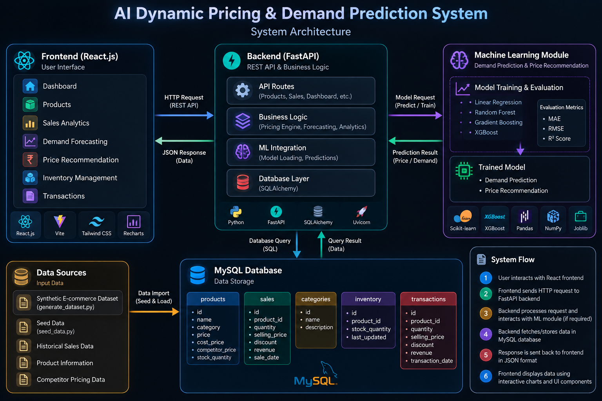

# AI Dynamic Pricing & Demand Prediction System

An AI-powered e-commerce analytics system that combines demand forecasting, dynamic pricing, sales analytics, inventory monitoring, and machine learning to support data-driven pricing decisions.

This project was developed as a B.Tech Data Science & AI/ML project.

---

## 🚀 Project Overview

The system analyzes historical e-commerce sales data and product information to:

- Forecast future product demand
- Recommend optimized product prices
- Analyze revenue and sales trends
- Monitor inventory levels
- Compare machine learning models
- Provide real-time business analytics through a web dashboard

The application uses a FastAPI backend, React frontend, MySQL database, and machine learning models for demand prediction.

---

## ✨ Key Features

### 📊 Executive Dashboard

- Total products
- Total revenue
- Total units sold
- Low-stock monitoring
- Revenue trend visualization
- Category-wise revenue breakdown

### 📦 Product Management

- Product catalog
- Category information
- Current selling price
- Cost price
- Competitor price
- Current stock

### 📈 Demand Forecasting

- Product-wise demand prediction
- 7, 14, and 30-day forecasting
- Interactive demand forecast charts

### 💰 Dynamic Price Recommendation

The pricing engine considers factors such as:

- Current product price
- Competitor price
- Cost price
- Predicted demand

The system generates:

- Recommended price
- Price adjustment percentage
- Predicted demand
- Expected revenue
- Pricing explanation

### 📉 Sales Analytics

- Monthly revenue trends
- Category revenue analysis
- Top-selling products
- Interactive charts

### 📦 Inventory Management

- Total stock units
- Inventory value
- Low-stock detection
- Out-of-stock detection
- Product-wise inventory status

### 🧾 Transaction Management

- Sales transactions
- Quantity sold
- Selling price
- Discounts
- Revenue
- Promotional transaction tracking

### 🤖 Machine Learning Model Evaluation

The system evaluates multiple regression models:

- Linear Regression
- Random Forest
- Gradient Boosting
- XGBoost

Model performance is evaluated using:

- MAE
- RMSE
- R² Score

---

## 🧠 Machine Learning

The project uses supervised machine learning for demand prediction.

### Models Evaluated

| Model | MAE | RMSE | R² |
|---|---:|---:|---:|
| Linear Regression | 16.0331 | 23.5261 | 0.5869 |
| Random Forest | 13.0421 | 20.4320 | 0.6884 |
| Gradient Boosting | 12.9883 | 19.7446 | 0.7090 |
| XGBoost | 13.0228 | 20.5646 | 0.6844 |

The current trained system selects Gradient Boosting based on the recorded evaluation metrics.

---

## 🏗️ System Architecture



---

## 🛠️ Technology Stack

### Frontend

- React.js
- Vite
- Tailwind CSS
- Recharts
- Lucide React
- React Router

### Backend

- Python
- FastAPI
- SQLAlchemy
- Pydantic
- Uvicorn

### Machine Learning

- Scikit-learn
- XGBoost
- Pandas
- NumPy
- Joblib

### Database

- MySQL

### Development Tools

- VS Code
- Git
- GitHub
- REST API
- Swagger / OpenAPI

---

## 📁 Project Structure

```text
ai-dynamic-pricing/
│
├── backend/
│   ├── app/
│   │   ├── models/
│   │   ├── routes/
│   │   ├── schemas/
│   │   ├── services/
│   │   └── utils/
│   │
│   ├── ml/
│   ├── saved_models/
│   ├── requirements.txt
│   ├── seed_data.py
│   └── train.py
│
├── frontend/
│   ├── src/
│   │   ├── components/
│   │   ├── pages/
│   │   ├── services/
│   │   ├── App.jsx
│   │   └── main.jsx
│   └── package.json
│
├── data/
│   └── synthetic_ecommerce_data.csv
│
├── scripts/
│   └── generate_dataset.py
│
├── docs/
│   └── system-architecture.png
│
├── database_schema.sql
├── README.md
└── .gitignore